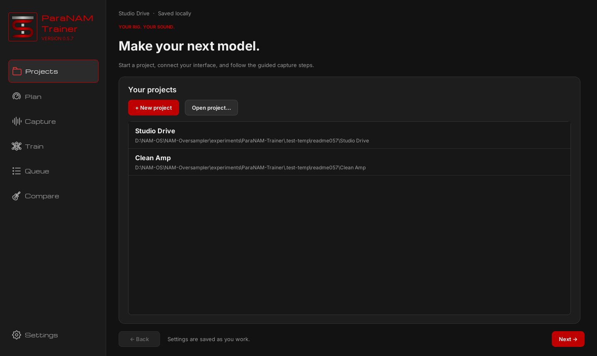
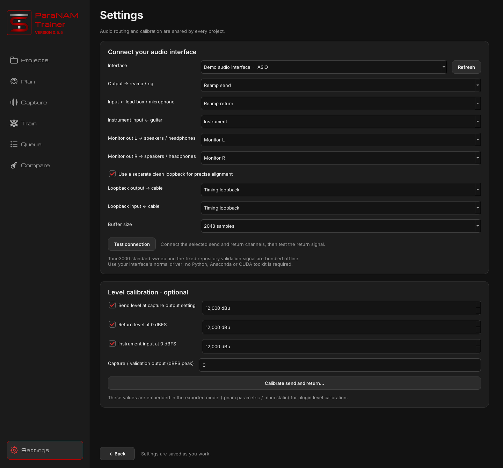
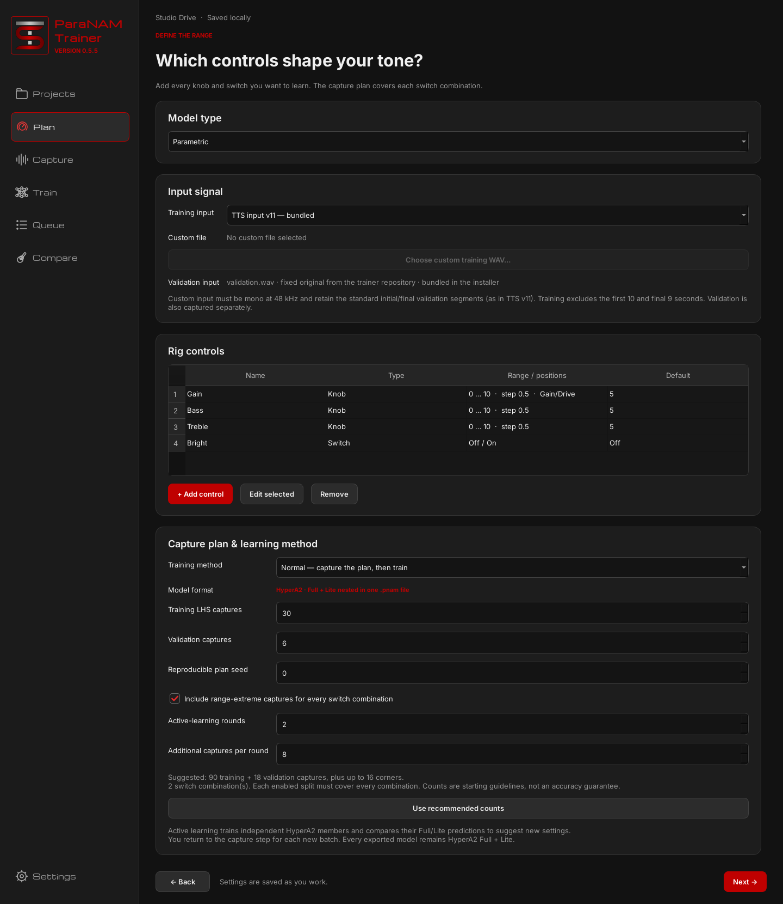
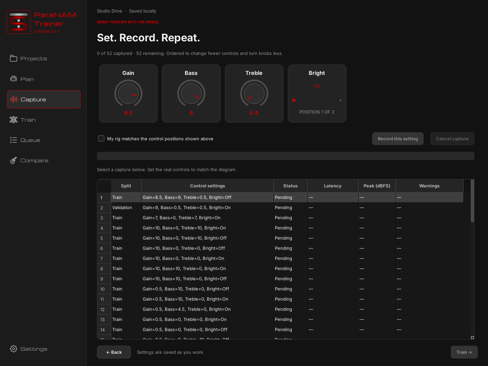
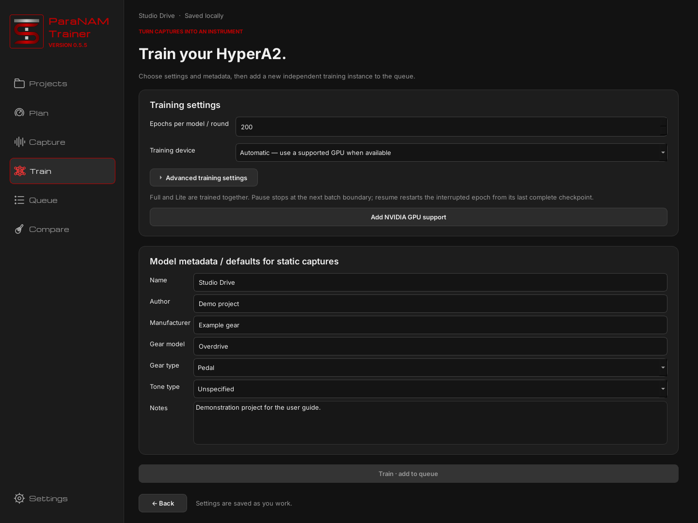
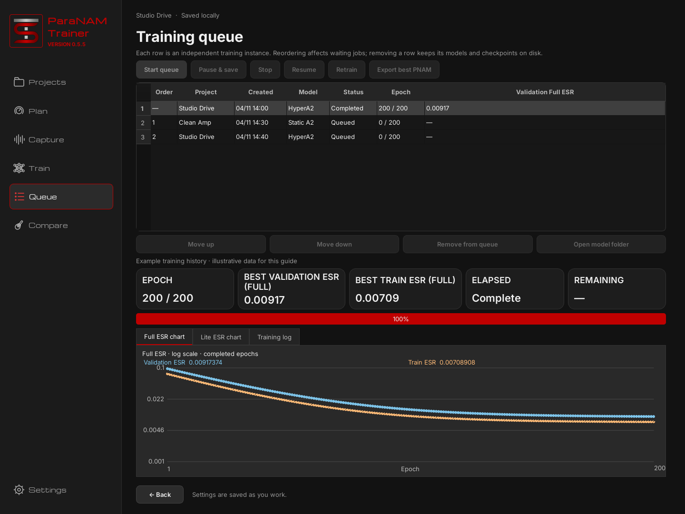
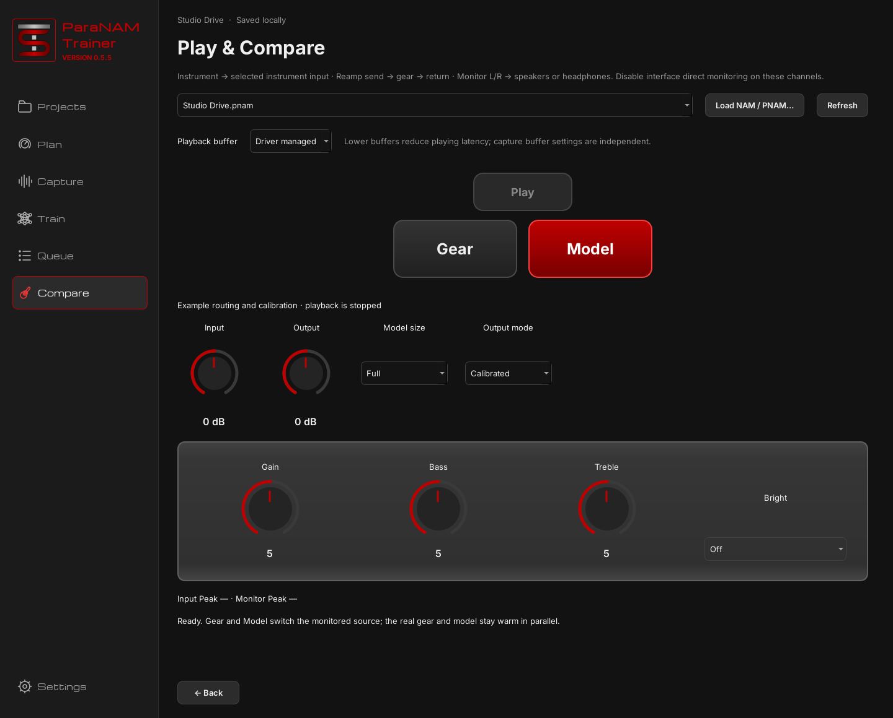

# ParaNAM Trainer

Capture your gear, train a model, and compare it with the real rig in one desktop app.
ParaNAM supports parametric models with knobs and switches, and batches of static models.

**[Download ParaNAM Trainer](https://github.com/DLC86/ParaNAM-Trainer/releases)**

| Model type | Result |
| --- | --- |
| **Parametric** | One `.pnam` with **ParametricSlimmableContainer Full + Lite**, with the controls you defined |
| **Static** | An independent `.nam` containing **A2 Full + Lite** for each named capture |

Both sizes are trained together. There is no Full/Lite choice at capture time;
select the playback size later in a compatible player.

## 1.0.0 draft

The 1.0.0 release is being prepared as an unpublished GitHub Release draft;
its five native installers will be attached only after their platform tests
and frozen-application checks have passed.

- Parametric capture planning temporarily offers **Normal** only. The
  Training method selector, Active Learning fields and explanation are hidden,
  but the existing Active Learning implementation remains in the source for
  future restoration. Opening old projects in the UI uses Normal for new captures;
  existing independently queued training instances retain their frozen settings.
- **Compare** centers the model's controls within each wrapped row, including
  rows with fewer controls than the available panel width.
- **Capture** paints the entire selected running row pure bright green
  (`#00FF00`), including warnings, labels and control settings.
- PNAM exports include the Plan display `index` for every neural control,
  sharing the sequence with Linear Volume while retaining the original
  hypernetwork input order.

The original 0.7.2 release remains available.

## 0.7.2 preview

[Find ParaNAM Trainer releases and drafts](https://github.com/DLC86/ParaNAM-Trainer/releases).

- Captures and Queue retain each row's original status text color while selected.
- The Plan page offers Standard, Maximin, Orthogonal and Near-orthogonal LHS designs.
- Recommended LHS capture counts increase from 15 to **16 per control**.
- Existing plans keep their selected design (Standard for older projects) until regenerated.

Orthogonal uses a strength-2 orthogonal-array LHS and requires a prime-square
number of samples per split and Complex Switch combination (e.g. 9, 25 or 49)
with no more than p+1 sampled dimensions for n=p². Anchoring, quantization,
control bias and switch mapping may weaken the theoretical design properties.

See [0.7.2 changes](docs/release-0.7.2.md) and
[previous 0.7.0 changes](docs/release-0.7.0.md).

## Credits

ParaNAM Trainer builds on **[Phillip Self](https://github.com/phillipmself)**'s
[parametric trainer](https://github.com/phillipmself/neural-amp-modeler-parametric),
including its capture workflow, parametric models and hypernetwork implementation,
and **[Steven Atkinson](https://github.com/sdatkinson)**'s
[Neural Amp Modeler](https://github.com/sdatkinson/neural-amp-modeler).
Native playback also derives from Phillip Self's NAM Parametric Plugin and
NeuralAmpModelerCoreParametric. This fork's desktop application and extensions
are maintained by [DLC86](https://github.com/DLC86).

See [CREDITS.md](CREDITS.md) for contributors and component-specific attribution,
and [THIRD_PARTY_NOTICES.md](THIRD_PARTY_NOTICES.md) for licenses and asset sources.

## Install

Choose the package for your computer from the linked release:

| System | Package | Training options |
| --- | --- | --- |
| Windows 10/11 x64 | Setup `.exe` | CPU; optional NVIDIA GPU support |
| macOS Apple Silicon | `.dmg` | Apple Metal or CPU |
| macOS Intel | `.dmg` | CPU |
| Ubuntu/Debian-compatible Linux x64 | `.deb` | CPU; optional NVIDIA GPU support |
| Other compatible Linux x64 desktops | Portable `.tar.gz` | CPU; optional NVIDIA GPU support |

The installers include Python, Qt, PyTorch, the audio libraries and the bundled
capture signals. End users do not need Anaconda, a CUDA toolkit, build tools or a
terminal. Install your audio interface's normal driver.

Windows setup offers optional NVIDIA support, with its progress shown inside the
installer. Linux offers it on first launch. You can also use **Add NVIDIA GPU
support** on the **Train** page; the button is hidden when the component is already
installed. The GPU engine is downloaded from official sources, stored outside the
app and reused across updates. A compatible NVIDIA driver is required. CPU
training and the bundled capture signals work offline.

macOS uses Metal where supported, with separate Apple Silicon and Intel packages.
Builds are unsigned, so macOS may require allowing the app through its normal
security interface. Linux packages target Ubuntu 22.04 or newer and compatible
system libraries.

## The workflow

The sidebar contains **Projects → Plan → Capture → Train → Queue → Compare**.
**Settings** stays at the bottom of the sidebar. You can return to earlier pages
to edit the setup; changes that require new captures preserve the old recordings
in the project's History.

The screenshots below show the current interface with a demonstration project
and example audio-interface labels. The Queue chart uses illustrative history,
not a model-quality or training-speed benchmark.

### Projects

Create a project with **+ New project**, use **Open project…**, or double-click a
recent project. Opening a project takes you directly to **Plan**. Projects are
saved locally as you work, and file dialogs remember the last folder you opened.



### Settings — routing and level calibration

Choose the audio interface and its driver-reported channels:

- **Output → reamp / rig** and **Input ← load box / microphone** form the capture path.
- A separate loopback output/input pair provides the clean timing reference;
  loopback is enabled by default.
- **Instrument input** receives the guitar for comparison playback.
- **Monitor out L/R** feed speakers or headphones.

Disable direct monitoring on the channels used for comparison. Capture buffer
choices come from the driver: **2048 samples** is the default when available,
otherwise the highest reported value is used. If the driver does not expose a
buffer size, the app shows **Driver managed**.

Audio routing is global. Calibration values used for captures are also retained
in the project and each training instance, so later global changes do not rewrite
the calibration of an existing dataset or queued job.

**Calibrate send and return…** provides a sine generator, initially 1 kHz at
0 dBFS peak. Its frequency and level are adjustable. Enter the measured RMS
voltage to calculate send dBu, then connect that measured signal directly to the
return or instrument input to calculate its calibration from the recorded dBFS
level. Level fields support three decimal places.

The selected capture output level also attenuates the training and validation
signals during recording. Instrument calibration is used in **Compare**.
See the [level-calibration guide](docs/level_calibration.md) for the procedure.



### Plan — model type, input signal and controls

Select **Parametric** or **Static** under **Model type**. **Input signal** offers:

- **Standard — bundled TONE3000 sweep**.
- **TTS input v11 — bundled**.
- **Custom** — a training WAV from your computer.

The separate validation signal is always the original bundled `validation.wav`.
Custom inputs must be mono at 48 kHz and preserve the standard initial/final
validation segments, as TTS v11 does. Training excludes the first 10 and final
9 seconds of each input/recording pair.

For parametric models, **+ Add control** lets you choose a knob or switch. Knobs
have ranges, steps and defaults; switches have a position count, a name for each
position and a default position. Multiple switches are supported, and the plan
covers every combination of their positions. Up to two knobs can be marked
**Gain/Drive**: corners cross both gain extremes with the other controls.

**Capture plan & learning method** offers **Normal** and **Active learning**,
training/validation capture counts, a reproducible seed and optional range-extreme
captures. Recommendations account for the controls and switch combinations.
New plans include the default control setting within the requested count, and
capture order is arranged to reduce knob movement.

In **Static** mode, control and parametric-plan settings are hidden. Add and name
the independent captures on the next page instead.



### Capture — set the gear and record

For a parametric project, the diagram shows the knob and switch positions for the
selected capture. Set the real gear to match, confirm the checkbox, then choose
**Record this setting**. Static projects show a named capture batch instead of
control positions.

The table keeps **Latency**, **Peak (dBFS)** and **Warnings** separate. Latency is
displayed as one fractional sample value. Columns can be resized, and the table
can still be scrolled during recording; selecting a different capture is locked
until recording finishes.

Each recording is aligned independently. Initial/final timing checks reject a
capture when drift reaches 0.1 sample, including fractional-sample drift, or timing
detection is unreliable. Rejected captures must be repeated; the app suggests a
larger interface buffer. Differences between reamp and loopback latency, or
latency changes between recordings, do not produce discrepancy errors. NAM's
one-sample safety factor is already included in prepared alignment.

Once every required capture is accepted, continue to **Train**.
See [capture timing](docs/capture_timing_margin.md) for the alignment details.



### Train — metadata and training setup

Set the epochs and training device, then enter the model metadata: **Name**,
**Author**, **Manufacturer**, **Gear model**, **Gear type**, **Tone type** and notes.
For a static batch, each model's name comes from **Capture**, so the Name field is
hidden here. Exported filenames follow the model Name, with filesystem-safe
characters.

**Advanced training settings** is collapsed by default. It contains Batch Size,
Adam/AdamW, Learning Rate, Hypernetwork Learning Rate, separate decay cadences and
manual decay controls for the audio network and hypernetwork, NY, Fit MRSTFT,
MRSTFT Weight, Weight Decay and the parametric hypernetwork options. The HyperWaveNet preset uses **AdamW**. HyperA2 and static A2 use batch 16 by default; selecting the
reference HyperWaveNet recipe initializes its batch and settings separately.

Each learning rate has a cadence selector: **per epoch** or **per 62 optimizer
updates (A2 cadence)**. Both decay values remain editable and independent.
Legacy presets display an equivalent decay using these two choices. Resuming an
existing job preserves its original frozen scheduler clocks and optimizer state;
new jobs use the displayed cadence and equivalent average decay. The discrete
reduction instants can differ between a legacy job and a newly retrained job.

New parametric projects default to **HyperA2**, **50 epochs** and batch 16.
Static projects default to **200 epochs**. HyperA2 uses Adam, audio/hypernetwork
LR **0.004/0.001**, decay **0.994/0.998497** per 62 updates, rank-2 deltas,
dilated convolution kernels excluded and summed Full/Lite losses. MRSTFT is on
(NY 8192, weight 0.0005); weight decay is 3.17e-7. Clipping, NaN/Inf gradient
scanning, cuDNN benchmark and deterministic training are off. HyperWaveNet is
unchanged except that cuDNN benchmark now defaults off. Existing projects keep
their saved settings. Hypernetwork settings are hidden in static capture mode.
The HyperA2/HyperWaveNet recipe selector changes training settings; parametric
exports remain **HyperA2 Full + Lite** in either case.

**Train · add to queue** creates a new independent training instance. It does not
replace an earlier run. See [training controls and presets](docs/training-controls.md)
and the [A2 training comparison](docs/a2-training-comparison.md) for more detail.



### Queue — manage jobs, progress and exports

The queue accepts static batches and parametric jobs and retains completed jobs.
Every instance keeps its own snapshot of recordings, settings and calibration.
You can edit the open project, open another project, or make new captures while
the training queue is processed.

Use **Start queue**, **Pause selected training**, **Cancel selected training** and
**Resume** here. All rows can be reordered; inactive jobs can be removed; removing a row keeps its files on disk. **Retrain**
reopens the original project on **Train** with the selected stopped, paused or
finished instance’s configuration, allowing changes before a new instance is queued.
Other training instances continue running independently. The **Name** column uses
the model metadata name (the first member’s name for a static batch).

The queue shows the epoch, best Validation ESR, best Train ESR, elapsed
time and ETA. Both best scores refer to Full. Remaining time updates from measured
batch throughput, with measured validation overhead once available. The log includes
iterations per second (it/s). **Full ESR chart**, **Lite ESR chart** and **Training log** show both
sizes separately. Checkpoint selection uses **Validation Full ESR**; both sizes'
scores are retained in exported metadata. Train ESR uses held-out audio from
training captures, while Validation ESR uses the separate validation captures.
While processing, **Start queue** becomes **Pause queue**. It pauses the current
job and leaves the remaining jobs waiting. **Start queue** resumes that job first.
Hover over either chart to inspect the nearest completed epoch: a vertical cursor
and the legend show that epoch's Validation and Train ESR values.

**Export best PNAM/NAM** is available once a suitable checkpoint exists, including
paused or stopped jobs. The button caption follows the selected job's model type.



Pause takes effect at the next train/validation batch boundary. Resume restores
the last complete checkpoint and restarts the incomplete epoch; it is tied to the
queue instance, not whichever project is open. Recovery is also available after
an interrupted or failed run when a valid checkpoint exists. You can lower batch
size or change the execution device before resuming, but changing optimizer
requires a new training run.

With **Active learning**, the ensemble recommends additional settings between
rounds. Use **Capture next active-learning round**, record them, then continue
training. Suggestions consider both Full and Lite and avoid already recorded
settings. Capture-count recommendations are starting guidelines, not accuracy
guarantees.

### Compare — play the model and the real gear

The **Compare** sidebar page opens **Play & Compare**. Load a `.nam` or `.pnam`,
select **Full** or **Lite** where supported, then press the **guitar button** for
live instrument input or the **play triangle** for a recorded audition signal.
Only one input source plays at a time; press its button again to stop. The selector
beside the triangle offers eight bundled TONE3000 preview inputs: Brit, Mayer,
Power, Jazz Hop, Fast Thrash, Hammer Lead, Downtown Bass and Garden Bass.
The same source feeds the model and the real reamp send. **Gear** and
**Model** switch the monitored source using the routing from Settings.

Input and Output both span **−20 to +20 dB**, with **0 dB** at the center. Parametric
controls appear on the black amp-style panel. Switches use discrete sliders,
with names aligned to knob labels and position labels aligned to knob values. Click a value to type it; double-click
a knob to restore its default. Typed values apply only after Enter or focus loss.
The model controls appear above **Input → Model size → Output mode → Output**.
The Instrument meter measures input before gain; stereo Monitor meters measure
outputs after gain and IR. Peak dBFS readings sit below the meters.

**Monitor IR** offers the six official Tone3000 preview IRs (Ampeg, Celestion,
Eminence, Mesa, Plate and Spring), plus custom mono/stereo WAV loading. IR defaults
to Off. Loading and resampling run in the background; changes crossfade during
playback. IR processing adds 256 samples (5.33 ms at 48 kHz), affects both Gear
and Model monitoring, and leaves the reamp send unchanged.
Custom IRs have no fixed duration limit and retain their complete tail; memory and
CPU requirements grow with the IR length.

You can change the model, model size and playback buffer while playback is active.
The playback buffer is independent of the capture buffer. Channel routing and
buffer choices are remembered per interface and driver API, including after
disconnecting/reconnecting the device or restarting the app. **Output mode** offers
**Raw**, **Calibrated** and **Normalized**; Calibrated is the default. Calibrated
and Normalized fall back to Raw when the required calibration or loudness data
is unavailable.



## Use exported models

Parametric `.pnam` files require a PNAM-compatible player, such as the
[NAM Parametric Plugin](https://github.com/DLC86/NamParametricPlugin/releases).
Static `.nam` files use the nested A2 Full/Lite format and need a player that
supports that format. Developers integrating PNAM into hardware can use the
[NeuralAudio PNAM fork](https://github.com/DLC86/NeuralAudio).

Models retain gear metadata, level calibration and Full/Lite ESR information.
Parametric training preserves level differences across control settings; it does
not apply per-setting RMS normalization.

## More information

- [0.6.2 changes](docs/release-0.6.2.md)
- [0.6.1 changes](docs/release-0.6.1.md)
- [0.6.0 changes](docs/release-0.6.0.md)
- [0.5.9 changes](docs/release-0.5.9.md)
- [0.5.8 changes](docs/release-0.5.8.md)
- [0.5.7 changes](docs/release-0.5.7.md)
- [0.5.6 changes](docs/release-0.5.6.md)
- [0.5.5 changes](docs/release-0.5.5.md)
- [Training controls and presets](docs/training-controls.md)
- [A2 architecture and training audit](docs/a2-training-comparison.md)
- [Level calibration](docs/level_calibration.md)
- [Capture timing and safety margin](docs/capture_timing_margin.md)
- [Earlier queue and comparison workflow details](docs/workflow-0.5.0.md)
- [Training performance measurements](docs/paranam-performance.md)

## Development

These commands are for contributors; end users use the installer.

```sh
python -m pip install -e '.[test]'
python -m paranam
python -m pytest tests/paranam -q
python -m pip install pyinstaller Pillow
python packaging/build.py --flavor CPU
```

Build on the target OS. Windows packaging uses Inno Setup, macOS uses `hdiutil`,
and Linux uses `dpkg-deb`; the native installer workflow provisions these tools.
Windows/Linux bundles use CPU PyTorch with an optional managed NVIDIA engine.
macOS builds use `--flavor Metal`; Intel uses the last official Intel-compatible
PyTorch 2.2.2. AVX2 nam-cpu-trainer integration remains deferred.

ParaNAM is based on DLC86's `Knobs+Switch` trainer branch. The original
documentation is retained in [README_UPSTREAM.md](README_UPSTREAM.md).
See [LICENSE](LICENSE) and [THIRD_PARTY_NOTICES.md](THIRD_PARTY_NOTICES.md) for
credits and bundled components. The interface uses the TTS logo and title font
from NAM On Steroids; the logo links to [The Tone Scientist](https://shop.thetonescientist.com).

Advanced settings also offer cuDNN benchmark and strict deterministic training for reproducible comparisons. See [training controls](docs/training-controls.md#reproducible-comparisons) for scope and limitations.


Unexpected-shutdown recovery preserves damaged files, restores valid state backups,
and rebuilds training progress from complete checkpoints. A recovery notice explains
what was recovered; **Review recovery** offers backup restoration and queue rebuilding
when automatic repair is insufficient. See [recovery details](docs/state-recovery.md).

### Updates

The app checks the published Latest release on GitHub in the background at launch.
A newer version offers **Download and install**, **Release notes**, and **Dismiss**.
Dismiss is remembered for that release, with a clickable blinking LED beside VERSION;
a subsequent release can notify again. Downloads are checked against GitHub's SHA-256
and size. Installation waits for a safe app shutdown, pausing active training first.
Native installers update the installed application and reopen it; system authorization
may be requested on macOS or Debian. Linux portable updates retain the previous app
folder. No update replaces project recordings, queue data or checkpoints.
Every audio routing selector also offers **None**; required capture/playback routes
must be assigned before starting those operations. Unassigned Settings meter channels
read silence and do not receive test noise.
